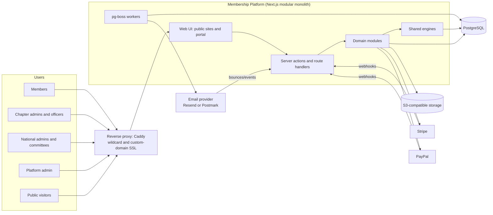
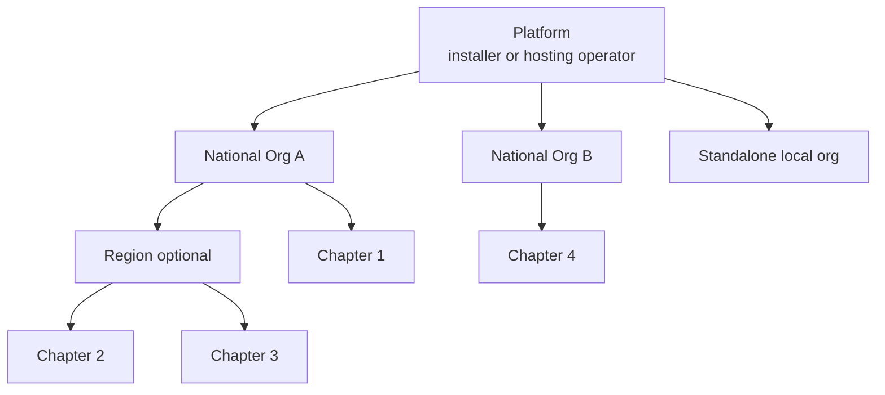
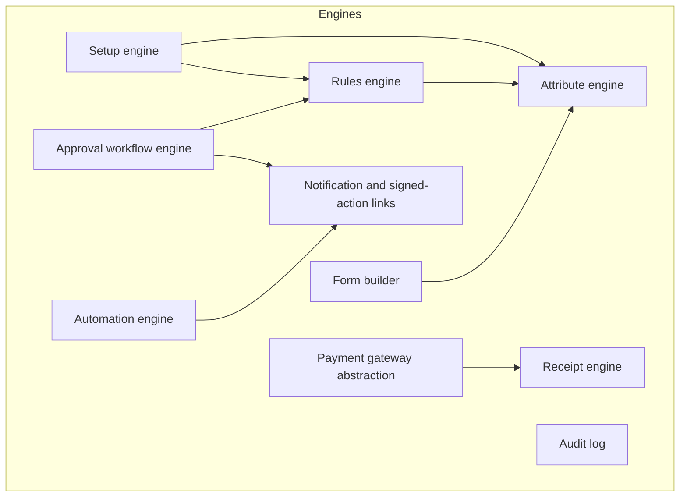
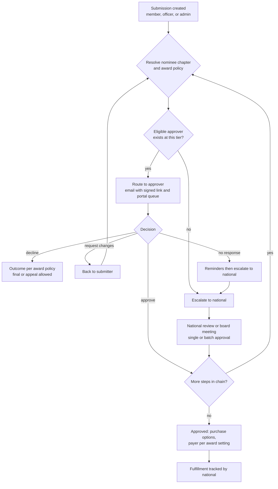
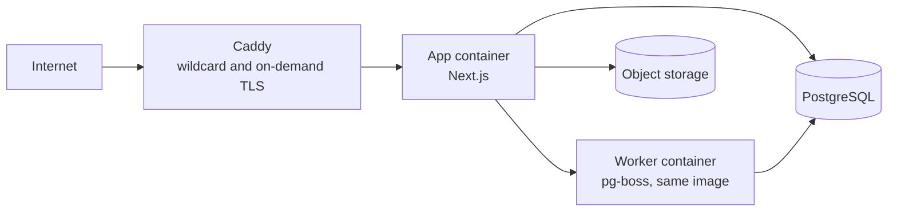

# Architecture Map

High-level only. This describes the shape of the system and the shared engines. Schemas, APIs, and screens come later.

## 1. Architectural style

A **modular monolith**: one Next.js + TypeScript codebase, one deployable app, one PostgreSQL database. Modules are separated by folder and enforced boundaries (each module exposes a small public interface and does not reach into another module's tables). This keeps self-hosting simple while leaving room to extract services later if ever needed.

## 2. System context



> **Diagram description:** A left-to-right system context diagram. On the left are five user groups: Members, Chapter admins and officers, National admins and committees, Platform admin, and Public visitors. All five connect to a reverse proxy (Caddy, handling wildcard and custom-domain SSL). The proxy passes traffic to the Web UI (public sites and portal), which sits inside a box labeled Membership Platform (Next.js modular monolith). That box contains five parts: Web UI, Server actions and route handlers (the API), Shared engines, Domain modules, and pg-boss workers. Inside the box, the Web UI calls the API, the API calls the Domain modules, and the Domain modules call the Shared engines. The Domain modules and the Shared engines both read and write PostgreSQL. The pg-boss workers also use PostgreSQL and send mail through the email provider (Resend or Postmark). The Domain modules additionally connect to S3-compatible storage, Stripe, and PayPal. Stripe and PayPal send webhooks back to the API, and the email provider sends bounce and delivery events back to the API. The reverse proxy is the intended target and its packaging is deferred (F-11).

## 3. Organization hierarchy



> **Diagram description:** A top-down hierarchy map. Platform (installer or hosting operator) is the top rung, with three organizations directly below it: National Org A, National Org B, and a Standalone local org. Directly below National Org A are a Region (optional) and Chapter 1. Chapter 2 and Chapter 3 sit below the Region. Chapter 4 sits directly below National Org B. The Standalone local org has no children. This shows that a chapter may hang directly off a national or off a region, and that the region tier is optional.

- A single `organization` concept with a `type` (national, region, chapter, standalone) and a parent. A standalone local org is simply a root org with no children.
- **Permissions and settings flow downward.** Data visibility flows **upward only where explicitly shared or required** (e.g., national sees members of its chapters, documents shared with national).
- The **region tier exists in the data model from day one** (D-035). Region-specific features, such as regional approvals, are built later.
- The **platform tier** exists above all orgs. On self-hosted installs it is the installer. On our hosted service it is us, managing customer orgs and hosting billing, which is separate from any org's own payment accounts.

## 4. Tenancy and request resolution

1. **Host-based resolution.** Middleware maps the incoming hostname to an organization:
   - `*.nationaldomain` → chapter by subdomain slug (default).
   - Verified custom domains table → chapter (optional, per D-033).
   - Bare national domain → national.
   - Admin and portal routes use the same host, scoped by the signed-in user's permissions.
2. **Org context** is set per request and is carried into the database session so **Row-Level Security** policies enforce isolation as a second line of defense behind application checks.
3. **Scope path.** Org hierarchy is stored so "this org and all descendants" queries are cheap (closure table or path column, decided at schema design).
4. **Custom domains:** DNS verification, then certificate issuance by the reverse proxy (on-demand TLS gated by an "is this a verified domain" check).

## 5. Authorization model

- **RBAC scoped to an org node.** A role assignment is (person, role, org node). It applies at that node and **inherits downward**.
- **Permissions** are fine-grained capabilities (`members.read`, `awards.approve`, `documents.manage`, and so on). Roles are bundles of permissions. Platform ships default roles. Orgs may define more.
- **Board seats generate role assignments.** Appointing a person to the Chapter President seat creates the linked assignment, ending the term removes it. Titles are display only.
- **Eligibility gates** layer on top of permissions: an officer or approver must also be in good standing, and some actions require a rank.
- **Every authorization decision** goes through one policy layer, never ad hoc in components.

### Identity across organizations

- A **person** is global to the install and owns the login identity (email, credentials, sessions). Everything else belongs to a **membership in a specific org**: profile fields, attribute values, preferences, consents, and standing.
- **Signing up for an org with an email that already has an account** adds that person to the new org. The person proves ownership by signing in (or verifying the email), and the sign-up flow never reveals to anyone that an account already exists elsewhere.
- **No cross-org data flow.** If two orgs both have an "address" attribute, the second is blank. It is not pre-filled or offered. Orgs and their admins cannot see a person's other memberships.
- **Org switcher:** a person with roles in several orgs picks the active org context. Permissions and data are evaluated per org context, and each context's data stays separate.
- Duplicate accounts from different emails are accepted. A manual admin merge tool is a possible later addition.
- Consequence for the database: attribute values, profile data, and preferences are keyed by **membership** (person + org), not by person.

### Branding and logos

- Every org can have branding: logo (with light and dark variants), small icon or favicon, colors, and an email/receipt header image.
- **National sets the default.** A chapter may **override** with its own logo. Resolution falls back chapter → region → national → platform default, per asset, so a chapter can override only the logo and keep national's colors.
- National can set whether chapters may override branding (inherit / override allowed / locked), like any other setting.
- Resolved branding is used on the org's public site, the portal, **emails, receipts, certificates, and award documents**, always for the **issuing org** (a chapter receipt carries the chapter logo if it has one).
- Logos are stored in object storage with size and type limits, SVG sanitization, and generated size variants. Receipts store a reference to the branding version used so reissued documents stay faithful.

## 6. Shared engines

These are built once and reused. Most of the product's "intelligence" lives here.



> **Diagram description:** A top-to-bottom dependency diagram of ten shared engines inside one group labeled Engines. An arrow means "uses" or "depends on". The engines are: Attribute engine, Rules engine, Setup engine, Approval workflow engine, Form builder, Automation engine, Notification and signed-action links, Audit log, Payment gateway abstraction, and Receipt engine. The connections are: Setup engine uses the Attribute engine and the Rules engine; the Rules engine uses the Attribute engine; the Form builder uses the Attribute engine; the Approval workflow engine uses the Rules engine and the Notification engine; the Automation engine uses the Notification engine; and the Payment gateway abstraction uses the Receipt engine. The Audit log has no arrows because every module writes to it.

| Engine | Responsibility | Used by |
|---|---|---|
| **Attribute engine** | Org-defined fields on members, chapters, and other entities: type (text, number, date, single/multi select, boolean, ordered list such as rank), validation, visibility, who can edit, required, and value history where needed. Chapter attributes are defined by national, at setup or later | Members, chapters, pricing, eligibility, awards, forms, exports |
| **Rules engine** | Declarative conditions and effects, authored in a UI and stored as data. Example: *if attribute rank in [E1, E2] then price = X*. Also eligibility and approver rules. No arbitrary code | Pricing, voter/candidate eligibility, award routing, automations |
| **Setup engine** | Guided questionnaires that create configuration for each module, re-runnable, with national-driven setup for chapters. See `setup-engine.md` | Every configurable module |
| **Approval workflow engine** | Multi-step approvals with configurable steps, approver resolution (by role, rank, chapter), escalation, delegation to national, outcomes, appeals, batch approval, and audit | Awards first, then documents, applications, bylaw changes |
| **Form builder** | Org-defined forms with fields, conditional logic, file uploads, and linkage to attributes. Submissions are stored as structured data | Award submissions, applications, event registration, board reports |
| **Automation engine** | Domain events → jobs via pg-boss: scheduled checks, reminders, escalations, and notifications | All modules |
| **Notification and signed-action links** | Email and in-app notifications. **Signed one-click links** carry a single-use, expiring token bound to the approver and the specific request | Approvals, reminders, invitations |
| **Audit log** | Append-only record of admin actions, financial changes, governance, documents, awards, exports, elections | All modules |
| **Payment gateway abstraction** | One interface, Stripe and PayPal adapters, per-org credentials or connected accounts, transaction records capture receiving org, gateway, fees | Dues, donations, events, awards, future store |
| **Receipt engine** | Templated, immutable receipts driven by tax profile and item tax treatment. Manual and automatic. Void and reissue | All payments |

### Signed one-click approval links

Email security scanners and link previewers often **prefetch every link in an email**. A link that approves on a plain GET could be triggered by a scanner. So the link opens a **confirmation page** (with the optional comment field and the decision button), and the state change happens on submit. It is still one click from the email plus one confirmation, and it is safe. Tokens are single-use, expire, and are bound to the approver and request.

## 7. Domain modules

Modules call engines and each other only through public interfaces.

| Module | Notes |
|---|---|
| Organizations | Hierarchy (including region), settings, branding and logo override, tax profile, chapter wizard, chapter attributes |
| Identity and access | Global person and account, org membership on sign-up, org switcher, invitations, roles, assignments |
| Members | People, memberships per org, member attributes, standing, directory, lists and exports |
| Dues | Tiers, terms, pricing rules, prepaid/postpaid, balances, two-level dues and national controls |
| Governance | Role templates, seats, appointments, vacancies, board reports, oversight dashboard |
| Elections | Positions, nominations, voting (single, ranked choice), certification, auto-appointment |
| Documents | Libraries, categories, versions, visibility, change alerts, compliance tracking |
| Awards | Catalog, families, policies, submissions, routing, purchase, fulfillment |
| Payments | Gateways, transactions, invoices, refunds, national fee |
| Receipts | Templates, issuance, manual receipts, year-end statements |
| Donations and fundraising | Campaigns, recurring gifts, peer-to-peer, sponsorships |
| Events | Events, tickets, registrations, check-in, waitlists, FMV |
| Corporate | Company accounts, seats, company admin |
| Communications | Templates, segments, bulk email, reminders |
| Public sites | Public pages, forms, widgets, domains |
| Reporting and export | Dashboards, roll-ups, CSV exports, accounting export |
| Platform admin | Tenant management, hosting billing, usage metering, system settings |
| Store *(future)* | Generic products, cart, orders, vendors, inventory |

## 8. Payments architecture

- **One gateway interface** (create payment, create subscription, refund, webhook handling, payout reference) with **Stripe** first and **PayPal** later.
- **Each org connects its own account.** Every transaction stores: receiving org, gateway, gateway reference, gross, fees, any national fee, and the item type it paid for.
- **Two entities, two payments.** If a member owes both national and chapter dues, checkout produces two independent payments with two receipts. The cart UX presents them together but they are processed separately.
- **National fee:** optional. Stripe runs in one of two modes (D-049): **Connect**, where national's account is the Connect platform and application fees apply automatically, or **Direct**, where each org uses its own account and the fee is settled by invoice. PayPal mechanism is deferred, with invoicing the chapter as the fallback.
- **Webhooks** are the source of truth for payment state. Handlers are idempotent.
- Card data never touches our servers (PCI SAQ-A scope).

## 9. Approval workflow (awards as the reference case)



> **Diagram description:** A top-down flowchart of the award approval workflow. It starts with a submission created by a member, officer, or admin. Next the system resolves the nominee's chapter and the award's policy. A decision asks whether an eligible approver exists at this tier. If yes, the request is routed to the approver by email with a signed link and in the portal queue. If no, it is escalated to national. After routing, the approver's decision has four outcomes: approve, decline, request changes, or no response. Approve leads to a check for more steps in the chain. Decline leads to an outcome set by the award policy (final, or appeal allowed). Request changes sends the item back to the submitter, who resubmits and the flow returns to resolving the chapter and policy. No response triggers reminders and then escalation to national. Escalated items go to national review or a board meeting, where approval can be single or batch, and then rejoin the check for more steps. If more steps remain, the flow loops back to resolving the policy for the next step. If none remain, the award is approved, purchase options open with the payer set by the award's setting, and fulfillment is tracked by national.

Rank-based approval: when an approver must hold a certain rank, the chapter president can confirm the approver's rank, which sets a **rank verified flag** on the step so national's review is faster. Rank comes from the member attribute system.

## 10. Automation inventory (events → actions)

| Event | Actions |
|---|---|
| Chapter created | Run chapter wizard, prompt for required board seats, invite appointees |
| Officer appointed or removed | Grant or revoke access, notify chapter and national |
| Seat vacant beyond threshold | Alert chapter, escalate to national |
| Term ending soon | Prompt chapter to start election or appointment |
| Report due soon or overdue | Remind, escalate to national |
| Membership expiring or lapsed | Reminders, standing change, officer good-standing check |
| Postpaid invoice due or overdue | Notices, standing change per admin-set rules |
| Document updated or required document missing | Notify national, remind chapter |
| Award submitted, step pending, stalled, approved | Route, remind, escalate, notify stakeholders, start purchase |
| Election phase change | Open nominations, voting reminders, certify, appoint winners |

## 11. Documents and storage

- Files are stored in S3-compatible storage under org-scoped keys. Access is by short-lived signed URLs after an authorization check.
- Every upload creates a version. Metadata (type, visibility, uploader, effective date) lives in Postgres.
- Document type categories and required types are defined by national and inherited.

## 12. Deployment topology (target state, packaging deferred to F-11)

This is where we are heading. **Docker image, Compose file, and Caddy configuration are not built early** (D-012). During early development the app runs locally against a local Postgres using environment variables, and wildcard subdomains are tested with `*.localhost`.



> **Diagram description:** A left-to-right deployment diagram of the target topology (packaging deferred to F-11). Internet traffic goes to Caddy (wildcard and on-demand TLS), which forwards to an App container running Next.js. The App container connects to a Worker container (pg-boss, same image), to a PostgreSQL database, and to object storage. The Worker container also connects to PostgreSQL.

- **Self-host (later, F-11):** a Compose setup brings up app, worker, Postgres, and Caddy. Object storage can be MinIO or an external S3.
- **Hosted:** the same code and image, multiple installs or a multi-tenant install, plus the platform-tier admin and billing.
- Configuration through environment variables. No dependency on a single cloud vendor's proprietary features.

## 13. Cross-cutting concerns

| Concern | Approach |
|---|---|
| Security | RLS plus app-level authorization, CSRF protection, rate limiting, secrets in env or a secrets manager, encrypted storage of gateway credentials |
| Privacy | Consent tracking, data export and deletion tools, member privacy preferences honored in directories and exports, audited exports |
| Auditability | Append-only audit log, immutable receipts and certified election results |
| Observability | Structured logs, error tracking, job queue dashboards, health checks |
| Accessibility | WCAG 2.1 AA target for public and member-facing UI |
| Internationalization | English and USD first. Keep strings and currency out of hard-coded paths so it can be added |
| Testing | Unit and integration with Vitest, end-to-end flows with Playwright, with tenant-isolation tests as a first-class category |
| Backups | Documented backup and restore for self-hosters, automated for hosted |

## 14. Suggested repository layout (illustrative)

```
/src
  /app                 Next.js routes (public, portal, admin, api)
  /modules             domain modules, each with its own public interface
    /organizations /members /dues /governance /elections
    /documents /awards /payments /receipts /events ...
  /engines             attributes, rules, setup, approvals, forms,
                       automation, notifications, audit, payments-core
  /db                  schema, migrations, RLS policies
  /lib                 shared utilities
/docker                (added later, F-11) compose files, Caddy config
/docs                  these planning docs
```

## 15. Extension points (designed for, not built)

- **Generic store:** products and orders reuse the cart, payment gateway abstraction, and receipt engine. Awards purchase options are modeled as products from the start so the store is an extension, not a rewrite.
- **Vendor and inventory:** fulfillment records reference an optional vendor and inventory item later.
- **Regional tier:** the hierarchy and policy engine already allow a region level. Features switch on later.
- **Reply-by-email approvals:** the notification layer exposes an inbound hook later.
- **Delegate elections:** election eligibility rules can reference a delegate attribute or seat.
