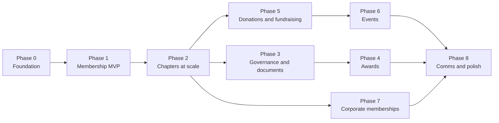
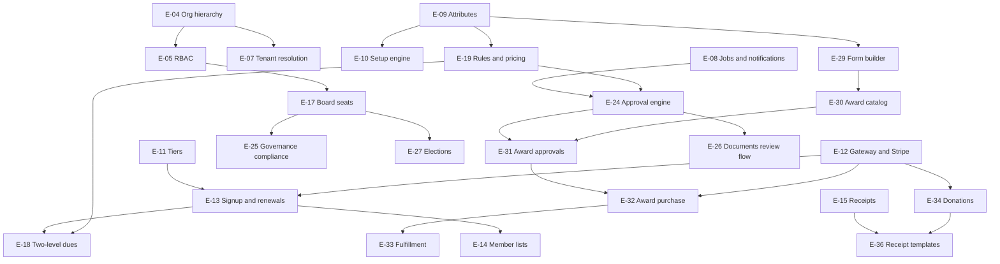

# Epic Map

High-level roadmap. Epics become backlog epics. Stories are written when an epic is pulled into planning. Epic IDs (`E-xx`) are stable. Phases can be reordered when dependencies allow.

## 1. Roadmap at a glance

> **Diagram description:** A left-to-right phase roadmap with nine phases. Phase 0 (Foundation) leads to Phase 1 (Membership MVP), which leads to Phase 2 (Chapters at scale). Phase 2 branches three ways: to Phase 3 (Governance and documents), to Phase 5 (Donations and fundraising), and to Phase 7 (Corporate memberships). Phase 3 leads to Phase 4 (Awards). Phase 5 leads to Phase 6 (Events). Phases 4, 6, and 7 all converge on Phase 8 (Communications and polish). Phases 3, 5, and 7 are therefore independent of each other once Phase 2 is done.

Phases 4 and 5 can swap or run in parallel if two streams are available. Hosted-service billing (E-42) can be pulled earlier if we want to start selling hosting sooner.

## 2. Epics by phase

### Phase 0: Foundation

| ID | Epic | Outcome |
|---|---|---|
| E-01 | Project scaffolding and CI/CD | Repo, lint, types, tests, CI pipeline, environments, npm scripts, local development setup (local Postgres, env vars, `.env.example`) |
| ~~E-02~~ | ~~Deployment packaging~~ | **Moved to the future backlog as F-11** (D-012). ID retired, not reused |
| E-03 | Identity and authentication | Global person and account, sign-in, sessions, email verification, password reset, invitations, **joining a new org with an existing account, org switcher** |
| E-04 | Organization hierarchy and platform tier | Org tree (platform, national, region, chapter, standalone), org settings, tax profile, **branding with logo upload and chapter override** |
| E-05 | RBAC and permissions | Roles, permissions, scoped assignments with downward inheritance, policy layer |
| E-06 | Audit log | Append-only log and viewer, hooks for all modules |
| E-07 | Host-based tenant resolution | Wildcard subdomain mapping (tested locally with `*.localhost`), org context per request, RLS wiring, tenant-isolation tests |
| E-08 | Jobs, email, and notifications infrastructure | pg-boss, email provider integration, template system, signed-action link service |

**Exit:** a national and a chapter can exist, users can sign in on the right subdomain, a chapter admin sees only their chapter, and every action is audited.

### Phase 1: Membership MVP

| ID | Epic | Outcome |
|---|---|---|
| E-09 | Custom attribute system | Org-defined member attributes (types, validation, visibility), attribute values on members, admin UI |
| E-10 | Setup engine framework + Membership setup flow | Reusable guided-setup framework, first flow covering members, attributes, tiers, and dues questions (see `setup-engine.md`) |
| E-11 | Membership tiers and terms | Org-defined tiers, term options, prices, tax treatment, prepaid model |
| E-12 | Payment gateway abstraction and Stripe | Gateway interface, Stripe adapter, transactions, webhooks, refunds |
| E-13 | Member signup and renewals | Public join form, application and approval (optional), renewals, lapses, grace periods, standing |
| E-14 | Member directory, lists, and exports | Member list with standing and time-to-expiration, filters, saved segments, privacy-aware CSV exports |
| E-15 | Basic automatic receipts | Receipt on payment, default template, receipt history |

**Exit:** a standalone org can complete setup, sell memberships through Stripe, renew them, see its roster, and export a mailing list.

### Phase 2: Chapters at scale

| ID | Epic | Outcome |
|---|---|---|
| E-16 | Chapter creation wizard and chapter attributes | National-led chapter creation, national-defined chapter attributes (e.g., charter date), prompts for required officers |
| E-17 | Board role templates and appointments | National-defined seats (required, count, term, permissions), custom titles, appointments with history, access grant and revoke |
| E-18 | Two-level dues and national controls | National and chapter tiers, none/optional-range/required chapter dues, locked or suggested structures, two-payment checkout UX |
| E-19 | Rules engine and attribute-based pricing | Declarative rules UI, pricing by attribute (e.g., rank bands), reused later for eligibility and approvals |
| E-20 | Postpaid dues | Balances, invoices, due dates, delinquency, admin-defined enforcement, manual payment recording |
| E-21 | Per-org gateways, PayPal, optional national fee | Each org connects Stripe or PayPal, **Stripe Connect and Direct modes**, PayPal adapter, national fee on chapter transactions |
| E-22 | Custom domains | Domain settings, DNS verification, on-demand TLS, subdomain remains default. **Needs a reverse proxy, so F-11 must be pulled forward before or with this epic** |
| E-23 | National roll-up reporting | Cross-chapter membership and revenue reporting |

**Exit:** national can create a chapter through the wizard, seat its officers, and have it collect its own dues, while national sees roll-ups.

### Phase 3: Governance and documents

| ID | Epic | Outcome |
|---|---|---|
| E-24 | Approval workflow engine | Generic multi-step approvals, approver resolution, escalation, delegation to national, batch approval, signed one-click links with confirmation page and comment |
| E-25 | Governance compliance | Vacancy alerts, good-standing checks for officers, board reports (types, schedules, submit, review), national oversight dashboard |
| E-26 | Document repository | Libraries, categories, required types, versions, visibility levels, change alerts to national, compliance dashboard |
| E-27 | Elections | Positions, eligibility, nominations, voting windows, single choice and ranked choice, hybrid entry, certification, auto-appointment, immutable results |
| E-28 | Automation engine expansion | Reusable triggers and schedules, the full automation inventory from `architecture.md` |

**Exit:** national sees vacancies, overdue reports, and document changes at a glance, and a chapter can run an election that seats its new board.

### Phase 4: Awards

| ID | Epic | Outcome |
|---|---|---|
| E-29 | Form builder | Org-defined forms with fields, conditional logic, uploads, attribute linkage. Reused by awards first |
| E-30 | Award catalog and approval policies | Awards, families and prerequisites, criteria, per-award forms, tiered approval chains, outcome and appeal settings, payer settings |
| E-31 | Submission, routing, and approvals | Submission flow, routing by chapter/role/rank, rank-verified flag, escalation to national, board-meeting batch approval, email link and portal approvals |
| E-32 | Award purchase and payer | Purchase options, add-ons (e.g., express fee), payer chosen per award or via form, chapter override, receipts, revenue to owning org |
| E-33 | Award fulfillment tracking | National-managed statuses (purchased, in production, shipped, presented), lead times, tracking, presentation date, awards dashboard, member award history |

**Exit:** a member can be nominated, routed to the right approver, approved or escalated, paid for by whoever the award allows, and tracked through shipping.

### Phase 5: Donations and fundraising

| ID | Epic | Outcome |
|---|---|---|
| E-34 | Donations | One-time and recurring gifts, designations (restricted/general), donation pages |
| E-35 | Fundraising | Campaigns with goals and progress, peer-to-peer pages, sponsorships |
| E-36 | Receipt templates, manual receipts, year-end statements | Template editor with national inheritance, manual receipts (cash, check, in-kind), void and reissue, year-end summaries |

### Phase 6: Events and registration

| ID | Epic | Outcome |
|---|---|---|
| E-37 | Events and registration | Events, ticket types, member vs non-member pricing, registration, check-in, capacity and waitlists, fair-market-value on receipts |

### Phase 7: Corporate memberships

| ID | Epic | Outcome |
|---|---|---|
| E-38 | Corporate memberships | Company accounts, seats, company admin, corporate tiers and billing |

### Phase 8: Communications and polish

| ID | Epic | Outcome |
|---|---|---|
| E-39 | Communications | Templates, segmented bulk email, scheduled reminders, announcements |
| E-40 | Public sites and widgets | Public chapter pages, listings, embeddable widgets, public awards roll |
| E-41 | Accounting export | Chart-of-accounts mapping per org, generic CSV by date range |
| E-42 | Hosted-service billing and tenant management | Platform admin, usage metering (orgs, chapters, active members), hosting plans and billing, thresholds as configuration |

## 3. Dependency map (key relationships)

> **Diagram description:** A top-down dependency map of selected epics. An arrow means "must come before". The connections are:
>
> - E-04 (Org hierarchy) leads to E-05 (RBAC) and E-07 (Tenant resolution).
> - E-05 (RBAC) leads to E-17 (Board seats).
> - E-09 (Attributes) leads to E-10 (Setup engine), E-19 (Rules and pricing), and E-29 (Form builder).
> - E-11 (Tiers) and E-12 (Gateway and Stripe) both lead to E-13 (Signup and renewals).
> - E-13 leads to E-14 (Member lists) and E-18 (Two-level dues); E-19 also leads to E-18.
> - E-17 (Board seats) leads to E-25 (Governance compliance) and E-27 (Elections).
> - E-08 (Jobs and notifications) and E-19 (Rules) both lead to E-24 (Approval engine).
> - E-24 leads to E-31 (Award approvals) and E-26 (Documents review flow).
> - E-29 (Form builder) leads to E-30 (Award catalog), which leads to E-31.
> - E-31 leads to E-32 (Award purchase), which leads to E-33 (Fulfillment); E-12 also leads to E-32.
> - E-12 leads to E-34 (Donations).
> - E-15 (Receipts) and E-34 both lead to E-36 (Receipt templates).

**Early design dependencies** (items later phases will need, so earlier phases must not close them off):

| Needed later | Must be anticipated in |
|---|---|
| Two-level dues (E-18) | Tier and membership model in E-11 and E-13 (membership belongs to an org, a person can hold several) |
| Rank-based pricing and approver rank (E-19, E-31) | Attribute types in E-09, including ordered lists |
| Setup engine for every module (E-10) | Every later module defines its setup flow as part of its epic |
| Awards as store products (future store) | Purchase options modeled as products in E-32 |
| Approval engine reuse (E-24) | Keep the engine generic, not award-specific |
| Payer flexibility (E-32) | Payment records reference an item and a payer separately from the person it benefits |

## 4. Future backlog (scoped, not scheduled)

| ID | Epic |
|---|---|
| F-01 | Generic store (merchandise, add-ons) on the shared cart and gateway connectors |
| F-02 | Vendor and inventory tracking for physical items and awards |
| F-03 | Delegate-based national elections |
| F-04 | Regional tier features and regional award approvals |
| F-05 | Reply-by-email approvals (inbound parsing) |
| F-06 | Virus scanning for document uploads |
| F-07 | PayPal national-fee mechanism |
| F-08 | Tool-specific accounting export formats |
| F-09 | Internationalization and multi-currency |
| F-10 | Mobile app or PWA enhancements |
| F-11 | **Deployment packaging:** Docker image, Docker Compose, Caddy configuration, backup and restore notes, upgrade notes (moved from E-02). Pull forward before E-22 (custom domains) or E-42 (hosted billing), or sooner if we need a shared test environment |

## 5. Scrum guidance

**Cadence (suggestion):** 2-week sprints. Phase 0 is roughly 3 to 4 sprints. Each later phase is roughly 4 to 8 sprints depending on team size. Treat these as placeholders until we have velocity.

**Slicing rules**
- Prefer **vertical slices** (a thin working path through UI, logic, and data) over layer-by-layer work.
- Engines (attributes, rules, setup, approvals, forms) ship with their **first real consumer** in the same phase so they are not built in a vacuum.
- Every module epic includes: its setup-engine flow, audit events, permissions, and automations. These are part of the epic, not separate "later" tickets.

**Definition of Ready (story)**
- Linked to an epic and relevant decision IDs.
- Acceptance criteria written, including permission and tenancy behavior.
- UI/UX notes or a sketch if user-facing.

**Definition of Done (story)**
- Code reviewed, tests passing (unit, integration, and e2e where user-facing).
- **Tenant-isolation test** added or updated for any new tenant-scoped data.
- Permissions enforced through the policy layer.
- Audit events emitted for meaningful actions.
- Migrations reversible or safely forward-only, and seed data updated.
- Docs updated (these planning docs, plus user or admin docs where relevant).
- Configuration comes from environment variables, with no hard dependency on a host-specific feature (keeps later packaging easy).
- Any diagram touched has its **description** updated in the same change.

**Per-epic exit criteria** are listed with each phase above. A phase is done when its exit statement is demonstrably true in a demo.
