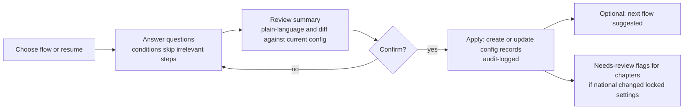

# Setup Engine

## 1. Purpose

Organizations differ a lot: term lengths, tiers, ranks, board structures, award chains. Rather than expose a wall of settings, the **setup engine** asks the important questions in plain language, in the right order, and turns the answers into configuration. It is also how national pre-configures chapters.

The setup engine **creates and edits configuration records**. It is not a separate source of truth. Anything it creates can be edited later in the normal admin screens, and the setup can be re-run.

## 2. Goals

1. A new org reaches a working configuration without reading documentation.
2. Questions are **contextual**: later questions depend on earlier answers.
3. Setup is **re-runnable and resumable**, and never destructive without confirmation.
4. National can **drive setup for chapters** (set once, inherited).
5. Every module owns its setup flow, so new modules get setup automatically.
6. Answers are shown back as a **plain-language summary** before anything is applied.

## 3. Core concepts

| Concept | Meaning |
|---|---|
| **Flow** | A setup sequence for one module (Membership, Governance, Awards, Payments, and so on) |
| **Step** | One screen or question group inside a flow |
| **Question** | A single prompt with a typed answer (yes/no, choice, number, attribute picker, rule builder, list builder) |
| **Condition** | Shows or skips a step based on earlier answers |
| **Outcome** | The configuration records a set of answers will create or update |
| **Preset** | A saved set of answers (platform-provided, national-provided, or user-saved) |
| **Setup state** | Per org and per flow: not started, in progress, applied, needs review |
| **Scope** | Which org level the answer applies to: this org only, or this org and descendants (inherit/override/locked) |

## 4. Lifecycle

> **Diagram description:** A left-to-right flowchart of the setup lifecycle. The user chooses a flow or resumes one, then answers questions (conditions skip irrelevant steps). Next comes a review summary, shown in plain language with a diff against current configuration. A decision asks whether to confirm. If no, the user returns to answering questions. If yes, the system applies the setup by creating or updating configuration records, which is audit-logged. After applying, two things can follow: the next flow may be suggested, and chapters get needs-review flags if national changed locked settings.

- **Draft answers are saved** as the user goes, so they can leave and return.
- **Apply is transactional.** Either the whole flow's configuration applies or none of it.
- **Re-running** pre-fills answers from current configuration and shows a diff of what would change.
- Changes that affect existing data (for example, changing a tier's price) present the impact ("12 active members renew at the old price until their next renewal") before applying.

## 5. National-driven setup

- National can define **setup defaults and locks** for chapters: "chapters may add their own tiers within this range," "this document type is required," "these board seats are required."
- When a **chapter is created**, the chapter wizard runs national-defined steps (attributes such as charter date, required officers) and then hands the chapter its own setup flows with national's guardrails already applied.
- Each setting has a **mode**: *inherit* (chapter follows national), *override allowed* (chapter may change), or *locked* (chapter cannot change).
- If national changes a setting after chapters are set up, affected chapters get a **needs-review** flag and a notification rather than silent changes.

## 6. Flows (initial set)

Each flow lists the kind of questions it asks. Wording is illustrative.

### 6.1 Organization
- Legal name, display name, EIN, tax status (501(c)(19), 501(c)(3), other).
- Is this a standalone organization or a national with chapters?
- Branding: upload a logo (light and dark variants), colors. *National:* may chapters upload their own logo, or is branding locked? *Chapters:* use national's logo or upload your own.
- Subdomain, and whether custom chapter domains are allowed.

### 6.2 Members and attributes
- What do you want to track about each member? Offer common starters (Salutation, Rank, Branch, Join date) and a "create your own" option.
- For each attribute: type (text, number, date, choice, multi-choice, yes/no, ordered list), allowed values, required, who can see it, who can edit it, show in directory.
- For ordered lists such as rank, define the order. Order matters for rules like "rank E5 or higher."
- Chapter attributes (national only): what do you want to track about each chapter (charter date, meeting location, and so on), and are they required at chapter creation?

### 6.3 Membership and dues
- What membership levels do you offer? What is each called?
- For each level: what terms are offered (any number, any length, lifetime optional) and the price per term.
- **Is any level priced based on a member attribute?** If yes: which attribute, and a rule builder (e.g., rank E1 to E2 pays X, E3 to E4 pays Y, E5 to E6 pays Z).
- **Should dues be reduced based on a previously defined attribute?** If yes: which attribute, what condition, and what reduction (fixed, percentage, or alternate price).
- Prepaid or postpaid? If postpaid: when is the invoice issued, how many days until due, and **what happens when it is late** (grace days, when standing changes, who is notified).
- Is approval required to join, and who approves?
- Grace period after expiration, and what standing is during grace.
- Tax treatment of dues (deductible, non-deductible, partially).
- *National only:* may chapters charge separate dues? None, optional within a min/max, or required. Are tier structures locked, suggested, or free?

### 6.4 Payments
- Connect Stripe and/or PayPal. *National:* use Stripe Connect (automatic fee) or let each org connect directly (fee by invoice)?
- Optional: charge chapters a fee? Percentage or fixed, and which transaction types.
- Receipt template basics (header, signature, footer) and who receives receipt copies.

### 6.5 Governance
- *National:* define board seat templates. For each: canonical role, default title, required or optional, seat count, term length, linked permissions.
- Can chapters rename titles? Can chapters add extra seats?
- Must officers be in good standing? (Default yes.)
- Board report types and schedules, and who reviews them.
- Vacancy alert thresholds and who gets notified.

### 6.6 Elections
- Who is eligible to vote and to run (membership status, minimum membership length, cutoff date logic)?
- Default voting method (single choice or ranked choice, chapter can choose if allowed).
- Nomination method, voting window length, quorum requirements.

### 6.7 Documents
- Document categories (bylaws, minutes, insurance, charter, and so on).
- Which are required for each chapter, which are shared with national by default, and which changes should alert national.

### 6.8 Awards
- Create an award or an award family: name, criteria, who can nominate, prerequisites.
- **Submission form**: build it or start from a template.
- **Approval chain**: how many steps, and for each step who approves (a role, a rank, a committee, national). What happens when no one is eligible (default: escalate to national). How long before reminders and escalation.
- **Outcomes**: is a decline final, or can the submitter appeal, and to whom?
- **Purchase options and add-ons**: names, prices, lead times, tax treatment.
- **Who pays?** Submitter, chapter, recipient, or ask on the form. May a chapter override the default?
- Who manages fulfillment (national by default)?

### 6.9 Events, donations, corporate, communications
Added with their epics, following the same pattern.

## 7. The rule builder (shared UI)

Several questions need a rule rather than a single value. The setup engine embeds the **rules engine's builder**, so the same component is used for pricing, eligibility, and approvals.

- Plain-language reading: "If **Rank** is **E1 or E2**, then **price** is **$25**."
- Choose an attribute, an operator (is, is one of, is at least, is before, and so on), and values. Combine with and/or.
- Choose an effect (set price, reduce by amount or percent, allow, deny, require approval, route to role).
- Show a **test panel**: pick a sample member and see the outcome.

## 8. Design constraints

- **Declarative only.** Flows are defined as data (steps, questions, conditions, outcomes), so adding a flow does not require bespoke UI code, and outcomes are validated by shared schemas.
- **No hidden state.** Everything setup does is visible in the normal admin screens afterward.
- **Permissions apply.** A chapter admin only sees flows and options national has allowed. Locked settings display as read-only with an explanation.
- **Auditable.** Applying a flow is a single audit event with a before/after diff.
- **Accessible and mobile-friendly**, since many officers will do setup from a phone.
- **Versioned flows.** When the product adds new questions in an update, existing orgs see a "new setup options available" prompt rather than a forced change.

## 9. Open design questions

1. Do presets from national travel with a chapter (copied) or reference national (live inheritance)? Proposed default: live inheritance with a per-setting override mode.
2. How are flows authored, as TypeScript definitions in the repo (simplest, versioned with code) or editable data? Proposed: TypeScript definitions in the repo at first.
3. How much of setup must work without an internet-connected integration (for example, before Stripe is connected)? Proposed: all flows except payment connection can complete, and payment-dependent features stay disabled until connected.
