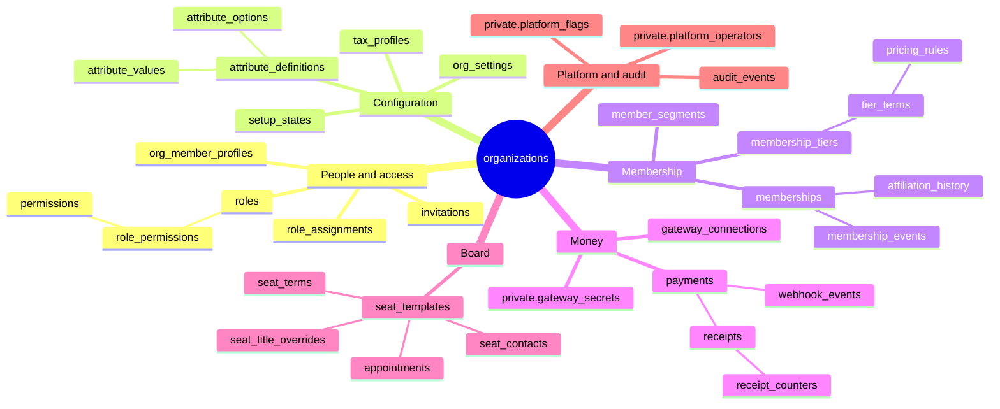
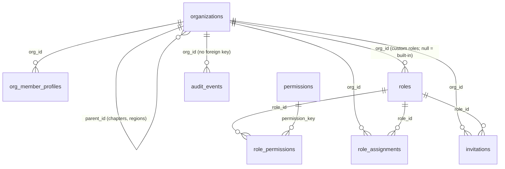
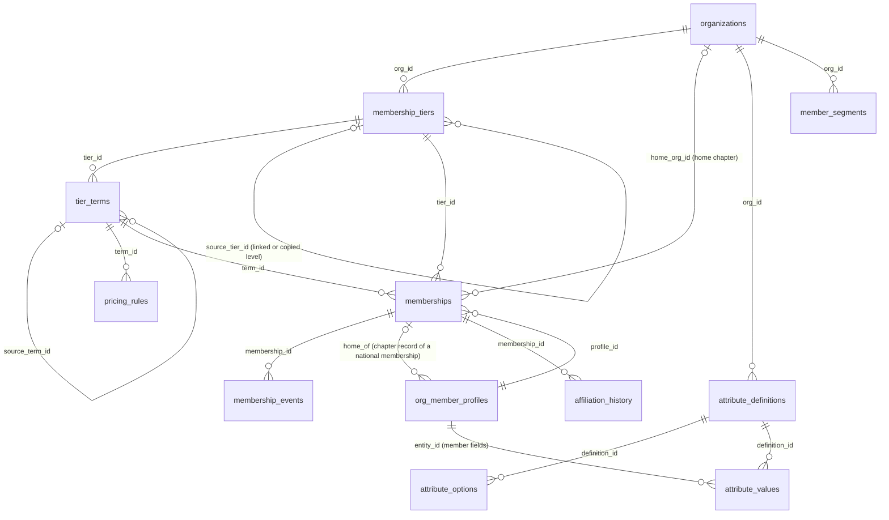
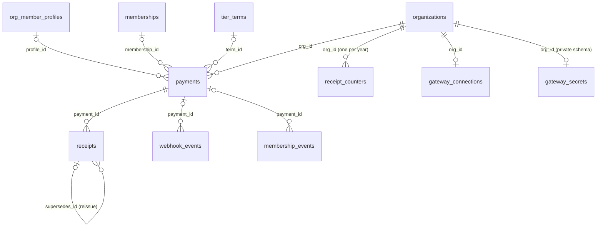
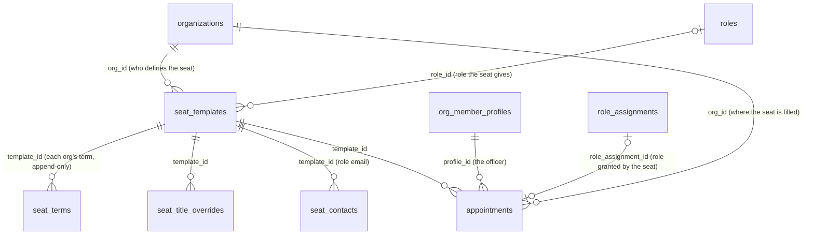
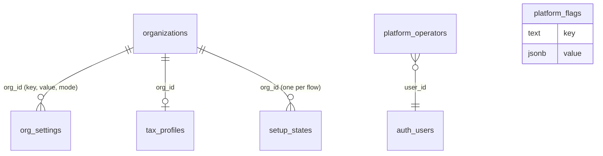

# Tables: what's stored and how it connects

A map of every database table in use, as of migration `0037`: what each table holds, what it links to, which migration created it, and how it may be written. Start with the mind map (§1) for the big picture. Use the diagrams in §2 to follow the links within each area, and the reference in §3 when you need a table's details.

For how the data is *meant* to be shaped (including things not built yet), see `data-domains.md`. For the rules behind it, see `decisions.md` and `architecture.md`. When a migration adds or changes a table, update this page in the same commit (§5).

**Conventions used throughout:**

- **Everything hangs off `organizations`.**
  - Every table has an `org_id` naming the organization the row belongs to, except these: `organizations` itself, the global `permissions` / `role_permissions` catalogue, and the two private `platform_*` tables.
  - Row-level security (RLS) uses `org_id` with `is_org_member` (members read) and `has_permission` (admins read and write). Both inherit downward only (D-032).
- **People:**
  - A sign-in account is a Supabase `auth.users` row. It is referenced by `user_id`, `actor_id`, `created_by` and similar columns, with no foreign key: accounts live in the managed `auth` schema.
  - A *person's record in an organization* is an `org_member_profiles` row. One account can have one record in each organization it belongs to.
- **Who may write:**
  - **"RLS"** means the app writes the table directly and a policy checks permission.
  - **"Functions"** means there's no write policy at all, and only `security definer` functions (RPCs and triggers) write it.
  - Nothing is deleted from the API except settings overrides and saved views.
  - Tables marked *append-only* refuse updates and deletes by trigger.
- **On delete** (what happens to a row when the row it points to is deleted; this mostly matters when a demo organization is removed):
  - *cascade*: removed too
  - *set null*: the link is cleared
  - *blocks*: the delete is refused while rows still point at it

## 1. Mind map

> **Diagram description:** A mind map with `organizations` at the centre and six branches.
> - **People and access:** `org_member_profiles`, `roles` (with `role_permissions` below it and `permissions` below that), `role_assignments` and `invitations`.
> - **Configuration:** `org_settings`, `tax_profiles`, `setup_states`, and `attribute_definitions` with `attribute_options` and `attribute_values` below it.
> - **Membership:** `membership_tiers` with `tier_terms` below it and `pricing_rules` below that; `memberships` with `membership_events` and `affiliation_history` below it; and `member_segments`.
> - **Money:** `payments` (with `receipts`, then `receipt_counters`, below it, and `webhook_events` beside them), `gateway_connections` and `private.gateway_secrets`.
> - **Board:** `seat_templates`, with `seat_terms`, `seat_title_overrides`, `seat_contacts` and `appointments` below it.
> - **Platform and audit:** `audit_events`, `private.platform_operators` and `private.platform_flags`.
>
> A table placed under another one depends on it: it points to it, or only makes sense with it. The map groups tables by area. It doesn't show every link; the diagrams in §2 do.

**How the areas meet** (the links that cross branches):
- **A person's membership** joins People and Membership. A `memberships` row belongs to one `org_member_profiles` record and one level and term (`membership_tiers`, `tier_terms`).
- **Money points back at membership.** A `payments` row points to the member record, the membership and the term it paid for. Each paid payment gets a `receipts` row.
- **The board points at people and roles.**
  - An `appointments` row puts a member record (`org_member_profiles`) into a seat (`seat_templates`).
  - The appointment creates a `role_assignments` row when the seat carries a role (`seat_templates.role_id` → `roles`).
- **Member fields belong to people.** An `attribute_values` row holds one field's value for one member record, or for one organization in the case of chapter fields (`entity_id`).
- **Home chapters** (home-chapter model, D-174):
  - The national's `memberships.home_org_id` names the chapter.
  - In that chapter, an `org_member_profiles` row points back at the national membership through `home_of`.
- **Linked levels** (D-177): a chapter's `membership_tiers.source_tier_id` and `tier_terms.source_term_id` point at the national's level and terms.

## 2. Diagrams by area

Relationship notation: `||--o{` is "one to many", `|o--o{` is "zero or one to many", `||--o|` is "one to zero or one".

### 2.1 Organizations, people and access

> **Diagram description:** `organizations` points to itself through `parent_id`, which makes the national → region → chapter tree.
>
> Each organization has many `org_member_profiles` (people's records in it), `roles` (its custom roles; built-in roles have no organization), `role_assignments` and `invitations`.
>
> Roles connect to permissions:
> - A role has many `role_permissions` rows.
> - Each `role_permissions` row names one entry in the global `permissions` catalogue.
> - A role is given to people through `role_assignments` (account, role, organization).
> - An invitation names the role the invitee will get.
>
> `audit_events` belong to an organization by `org_id`, but without a foreign key, so the log outlives anything it describes.

### 2.2 Membership levels, memberships and member fields

> **Diagram description:**
>
> **Levels and prices.** An organization has many `membership_tiers` (levels). Each level has many `tier_terms` (lengths and prices). Each term may have `pricing_rules`. A chapter's level can point at the national level it was copied from or linked to (`source_tier_id`), and its terms likewise (`source_term_id`).
>
> **Memberships.** A member record (`org_member_profiles`) has memberships. Each membership names one level and one term, and has a history of `membership_events`.
>
> **Home-chapter model.**
> - A national membership may name a home chapter (`home_org_id` → `organizations`).
> - In that chapter, a member record points back at the national membership (`home_of`).
> - Every chapter change is logged in `affiliation_history`.
>
> **Member fields.** An organization defines `attribute_definitions`. Each definition has `attribute_options` (for choice fields) and `attribute_values`. A value belongs to a member record (`entity_id`) for member fields, or to an organization for chapter fields.
>
> **Saved views.** `member_segments` are saved Members-page views, per organization.

### 2.3 Money

> **Diagram description:**
>
> **Payments.** An organization has many `payments`. A payment may point to:
> - a member record
> - a membership
> - the term it paid for
>
> A pending join has no membership yet.
>
> **Receipts.** A paid payment has one or more `receipts`. A reissued receipt points at the one it replaces (`supersedes_id`). `receipt_counters` holds one row per organization and year, for gap-free numbering.
>
> **Gateway events.** A `webhook_events` row may point at the payment it settled. A membership event can also point at the payment that caused it.
>
> **Gateway credentials.** Each organization has at most one `gateway_connections` row (the visible status of its Stripe or test connection). It also has at most one `private.gateway_secrets` row, which holds the sealed keys and is never exposed through the API.

### 2.4 Board, roles and appointments

> **Diagram description:**
>
> **Seats.** An organization defines `seat_templates` (officer seats). A seat may name the role it gives. The seat's `scope` says whether it is used by the organization itself, its chapters, or both.
>
> **Per-organization rows.** Each organization that uses a seat can have its own rows, all keyed by the seat:
> - `seat_terms`: the term from its by-laws (append-only)
> - `seat_title_overrides`: its own title, where allowed
> - `seat_contacts`: a role email
>
> **Appointments.** An `appointments` row puts one member record into one seat at one organization, with dates. When the seat gives a role, the appointment points at the `role_assignments` row it created, so ending the appointment removes only that role.

### 2.5 Configuration and platform

> **Diagram description:**
> - **Settings.** An organization has many `org_settings` rows. Each row is a key and value, with a mode: inherit, override or locked.
> - **Tax details.** An organization has at most one `tax_profiles` row (legal name, EIN, tax status, address, used on receipts).
> - **Setup progress.** An organization has one `setup_states` row per guided setup flow, holding the saved answers and whether they were applied.
> - **Platform tables.** In the private schema, `platform_operators` lists the sign-in accounts that may create demo organizations. `platform_flags` holds platform-wide switches, such as allowing the test gateway outside demo organizations. Neither belongs to an organization.

## 3. Table reference

"Created in" is the migration that created the table; later migrations that added columns are in brackets.

### 3.1 Organizations, people and access

| Table | What it holds | Key columns | Links to | Created in | Writes |
|---|---|---|---|---|---|
| `organizations` | Every organization: national, region, chapter or standalone | `parent_id`, `type`, `name`, `slug`, `ancestor_ids` (kept by trigger), `is_demo`, `logo_path` | itself (`parent_id`; *blocks*) | 0000 (0001 logo, 0022 demo) | Created only by `create_organization` / `create_demo_organization`; name, logo and similar by RLS (`org.manage`); removed only by `delete_demo_organization` |
| `org_member_profiles` | A person's record in one organization, with or without a sign-in account | `user_id`, `display_name`, `email`, `source`, `claimed_at`, `directory_listed`, `home_of`, `left_at` | `organizations` (*cascade*), `memberships` via `home_of` (*set null*) | 0000 (0008 source and claim, 0012 directory, 0030 home chapter) | Created by `create_organization` (the creator, top-level organizations only since 0038), `accept_invitation`, `admin_create_member`, `import_members` (0037), joining online (`payment_succeeded`) and a chapter change (`move_home_chapter`); own record updated by RLS (name), own email by `sync_my_email`; admins use `update_member_record`; taken off and back on the roster by `remove_member_record` / `restore_member_record` (sets `left_at`, never deletes). No insert policy |
| `roles` | Built-in roles (no `org_id`) and each organization's custom roles | `key`, `name`, `active` | `organizations` (*cascade*) | 0000 (0004 custom roles) | `create_role`, `update_role`, `set_role_active` (retired, never deleted) |
| `permissions` | The global permission catalogue (`members.view`, `payments.manage`, …) | `key` | — | 0000 | Migrations only |
| `role_permissions` | Which permissions each role has | `role_id`, `permission_key` | `roles`, `permissions` (*cascade*) | 0000 | `create_role`, `update_role` (no escalation beyond the creator's own) |
| `role_assignments` | An account holding a role at an organization (and, by inheritance, below it) | `user_id`, `role_id`, `org_id`, `source` | `roles`, `organizations` (*cascade*) | 0000 | `assign_role`, `remove_role`, `accept_invitation`, appointments; the last admin can't be removed |
| `invitations` | Copy-a-link invitations: single-use, email-bound, expiring | `email`, `role_id`, `token_hash`, `expires_at`, `accepted_at`, `revoked_at` | `organizations` (*cascade*), `roles` (*blocks*) | 0001 | `create_invitation`, `accept_invitation`, `revoke_invitation` (only the hash is stored) |
| `audit_events` | The append-only audit log | `actor_id`, `action`, `target_type`, `target_id`, `before`, `after`, `tx_id` (the save it belongs to) | `organizations` by `org_id`, with no foreign key | 0000 (0037 `tx_id`) | Triggers and `write_audit` only; no client writes. Read through `audit_log()` (names, one org only, setup drafts left out). *Append-only* |

### 3.2 Configuration

| Table | What it holds | Key columns | Links to | Created in | Writes |
|---|---|---|---|---|---|
| `org_settings` | Settings overrides, and locks for the organizations below | `key`, `value`, `mode` (inherit / override / locked) | `organizations` (*cascade*) | 0001 | RLS (`org.manage`); the `enforce_setting_lock` trigger refuses overriding a parent's lock. Declared in `src/engines/settings` |
| `tax_profiles` | Legal name, EIN, tax status and address for receipts | `org_id` (key), `tax_status` | `organizations` (*cascade*) | 0001 | RLS (`org.manage`) |
| `setup_states` | Saved answers of each guided setup flow | `flow_id`, `answers`, `status`, `applied_at` | `organizations` (*cascade*) | 0003 | Drafts by RLS (`setup.run`); applied only by `apply_setup` (one transaction, idempotent) |
| `attribute_definitions` | Member fields and chapter fields | `applies_to` (member / chapter), `key`, `label`, `data_type`, `required`, `visibility`, `member_editable`, `show_in_directory`, `locked`, `active` | `organizations` (*cascade*) | 0003 (0005 lock) | RLS (`attributes.manage`); retired with `active = false`, never deleted |
| `attribute_options` | Choices for choice-type fields (Rank E-1 … O-10) | `value`, `label`, `sort_order`, `active` | `attribute_definitions`, `organizations` (*cascade*) | 0003 | RLS; retired, never deleted |
| `attribute_values` | One field's value for one member record or one organization | `definition_id`, `entity_id`, `value` | `attribute_definitions`, `organizations` (*cascade*); `entity_id` is a member record or an organization | 0003 | Only `set_attribute_value` (validates type and options, checks who may edit) |

### 3.3 Membership

| Table | What it holds | Key columns | Links to | Created in | Writes |
|---|---|---|---|---|---|
| `membership_tiers` | Membership levels | `key`, `name`, `tax_treatment`, `active`, `suggested`, `source_tier_id`, `link_mode` (copy / linked), `price_rule`, `price_value` | `organizations` (*cascade*), the national's level via `source_tier_id` (*set null*) | 0006 (0032 suggested and linked levels) | RLS (`tiers.manage`) with the parent's rules (`tier_parent_check`; below a home-chapter national no levels at all, 0036); links only through `adopt_suggested_level`, `set_linked_level_price` and `make_level_own`; linked levels follow the national by trigger. Retired, never deleted |
| `tier_terms` | A level's lengths and prices (1 year, Lifetime) | `tier_id`, `key`, `label`, `length_count`, `length_unit`, `price_minor`, `currency`, `source_term_id` | `membership_tiers` (*cascade*), the national's term via `source_term_id` (*set null*) | 0006 (0032) | RLS, within the national's price range for chapters (`chapter_dues_range_check`); retired, never deleted |
| `pricing_rules` | Price by member fields, per term (first matching rule wins) | `term_id`, `label`, `conditions`, `price_minor` or `discount_pct`, `sort_order`, `active` | `tier_terms`, `organizations` (*cascade*) | 0021 | `save_pricing_rule`, `set_pricing_rule_active`, `apply_setup` (`pricing_rules` section) |
| `memberships` | A member record's membership in an organization: level, term, status and dates | `profile_id`, `tier_id`, `term_id`, `status`, `joined_on`, `paid_through`, `lifetime`, `home_org_id` | `org_member_profiles`, `organizations` (*cascade*); `membership_tiers`, `tier_terms` (*blocks*); home chapter (*set null*) | 0008 (0030 home chapter) | `record_membership`, `grant_membership_term`, `approve_membership`, `decline_membership`, `cancel_membership`, payment completion; home chapter by `set_home_chapter` / `set_member_home_chapter` |
| `membership_events` | Each membership's history: joined, renewed, approved, cancelled, refunded | `kind`, `tier_id`, `term_id`, `period_start`, `period_end`, `payment_id`, `actor_id` | `memberships`, `organizations` (*cascade*); levels, terms, payments (*blocks*) | 0008 | Functions only. *Append-only* |
| `affiliation_history` | Every change of home chapter (home-chapter model) | `membership_id`, `from_org_id`, `to_org_id`, `changed_by` | `memberships`, `organizations` (*cascade*); from/to chapters (*set null*) | 0030 | `set_home_chapter`, `set_member_home_chapter`. *Append-only* (only an organization's own deletion cascades through, 0033) |
| `member_segments` | Saved Members-page views (filters) | `name`, `filter`, `created_by` | `organizations` (*cascade*) | 0011 | RLS (`members.manage`), including delete |

### 3.4 Money

| Table | What it holds | Key columns | Links to | Created in | Writes |
|---|---|---|---|---|---|
| `payments` | Every payment: recorded by hand, Stripe or the test gateway; joins, renewals, refunds | `membership_id`, `profile_id`, `term_id`, `purpose`, `amount_minor`, `currency`, `status`, `gateway`, `method`, `gateway_ref`, `checkout_ref`, `livemode`, `refunded_amount_minor`, `join_answers` | `organizations` (*cascade*); member record, membership, term (*blocks*) | 0008 (0009 gateway, 0010 joining) | `record_membership`, `begin_join`, `begin_renewal`, `complete_gateway_payment`, `fail_gateway_payment`, `mark_payment_refunded` and the test gateway. Never deleted |
| `receipts` | Numbered receipts, frozen once issued | `payment_id`, `number`, `year`, `seq`, `status` (issued / voided / superseded), `supersedes_id`, `snapshot` | `payments`, `organizations` (*cascade*); the receipt it replaces (*blocks*) | 0013 | `issue_receipt`, `void_receipt`, `reissue_receipt`; a trigger refuses any other change |
| `receipt_counters` | The last receipt number per organization and year | `org_id`, `year`, `last_seq` | `organizations` (*cascade*) | 0013 | Receipt functions only (no gaps) |
| `gateway_connections` | An organization's payment connection as admins see it: gateway, status, test or live | `gateway`, `status`, `account_label`, `livemode` | `organizations` (*cascade*) | 0009 | `save_stripe_connection`, `connect_test_gateway`, `disconnect_gateway` |
| `webhook_events` | Gateway events already handled, so a replay does nothing | `gateway`, `event_id` (unique per gateway), `type`, `payment_id` | `organizations` (*cascade*), `payments` (*blocks*) | 0009 | `claim_webhook_event` (server only) |
| `private.gateway_secrets` | Each organization's sealed Stripe key and webhook secret | `org_id` (key), `sealed` | `organizations` (*cascade*) | 0009 | Server role only; the `private` schema is not exposed through the API |

### 3.5 Board

| Table | What it holds | Key columns | Links to | Created in | Writes |
|---|---|---|---|---|---|
| `seat_templates` | Officer seats an organization defines | `key`, `title`, `required`, `seat_count`, `default_term_count`, `default_term_unit`, `role_id`, `scope` (`self` / `chapters` / `self_and_chapters`), `active` | `organizations` (*cascade*), `roles` (*blocks*) | 0014 (0024 `self_and_chapters`) | `define_seat`, `update_seat`, `set_seat_scope`, `set_seat_active`, `apply_setup` (board) |
| `seat_terms` | Each organization's own term for a seat, from its by-laws | `template_id`, `length_count`, `length_unit`, `effective_from`, `bylaw_reference` | `seat_templates`, `organizations` (*cascade*) | 0014 | `set_seat_term`, `apply_setup`. *Append-only* (the term in force is the latest one started) |
| `seat_title_overrides` | An organization's own title for a seat, where the parent allows | `template_id`, `title` | `seat_templates`, `organizations` (*cascade*) | 0014 | `set_seat_title` |
| `seat_contacts` | A seat's role email at an organization (instead of the officer's own) | `template_id`, `role_email` | `seat_templates`, `organizations` (*cascade*) | 0026 | `set_seat_contact` |
| `appointments` | An officer in a seat at an organization, with dates | `template_id`, `profile_id`, `seat_number`, `starts_on`, `planned_end`, `ended_on`, `end_reason`, `role_assignment_id` | `seat_templates`, `org_member_profiles`, `organizations` (*cascade*), `role_assignments` (*set null*) | 0014 | `appoint_officer`, `end_appointment`; a chapter change ends seats (0030). Never deleted |

### 3.6 Platform

| Table | What it holds | Key columns | Links to | Created in | Writes |
|---|---|---|---|---|---|
| `private.platform_operators` | Accounts that run the platform: they may create and delete demo organizations | `user_id` | a sign-in account (no foreign key) | 0022 | By hand in the SQL editor |
| `private.platform_flags` | Platform-wide switches, such as allowing the test gateway outside demo organizations | `key`, `value` | — | 0009 | By hand in the SQL editor |

## 4. Common paths through the tables

How the app answers its most frequent questions, and which function does the joining:

| Question | Path | Function |
|---|---|---|
| Is this member in good standing? | `org_member_profiles` → their membership (their own here, or the national one through `home_of`) → `status`, `paid_through`, `lifetime`, and the organization's grace days from `org_settings` | `profile_membership_id`, `membership_standing`, `grace_days` |
| May this person do X here? | `role_assignments` (at this organization or any above it) → `roles` → `role_permissions` | `has_permission` (downward only) |
| What applies to this chapter? | `organizations.ancestor_ids` → each ancestor's `org_settings`, with the nearest lock winning | `effective_setting`, `lineage_settings` |
| Everyone in a national and below | `organizations` subtree → `org_member_profiles` → `memberships` | `org_subtree`, the Members "everyone" view, `org_rollup_members`, `org_overview_stats` |
| What does this member pay? | `tier_terms.price_minor` → the first matching `pricing_rules` row for their `attribute_values`; linked levels follow the national's term | `quote_price`, `term_price`, `linked_price` |
| Who's on the board, and how do I reach them? | `seat_templates` that apply here (`scope`) → current `appointments` → `org_member_profiles`; `seat_contacts` for a role email | `org_board`, `org_board_contacts`, `seat_applies_at` |
| Where did this money go? | `payments` → `receipts`, `membership_events`; `export_payments` for bookkeeping | `payments_receipts`, `export_payments` |

## 5. Keeping this page current

- A migration that **creates a table**: add it to the mind map (§1), the right diagram (§2) and the reference (§3). Update each diagram's description in the same change (diagram convention, `docs/README.md`).
- A migration that **adds a column or a foreign key**: update the key columns, links and "Created in" brackets.
- A **new write path** (an RPC or policy): update the Writes column.
- Check against a migrated test database (`bun run test:db` builds one) with `\d+ public.<table>` in `psql`. The perf script's database (`KEEP_DB=1 bun run test:perf`) is kept for exactly this kind of inspection.
